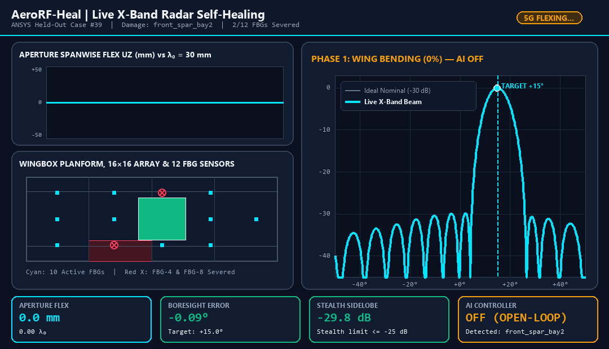
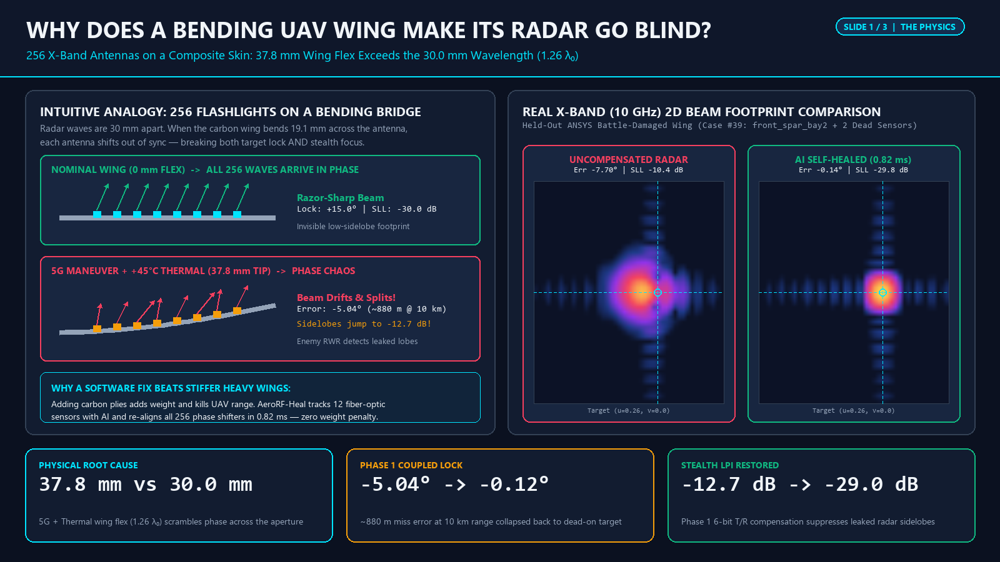
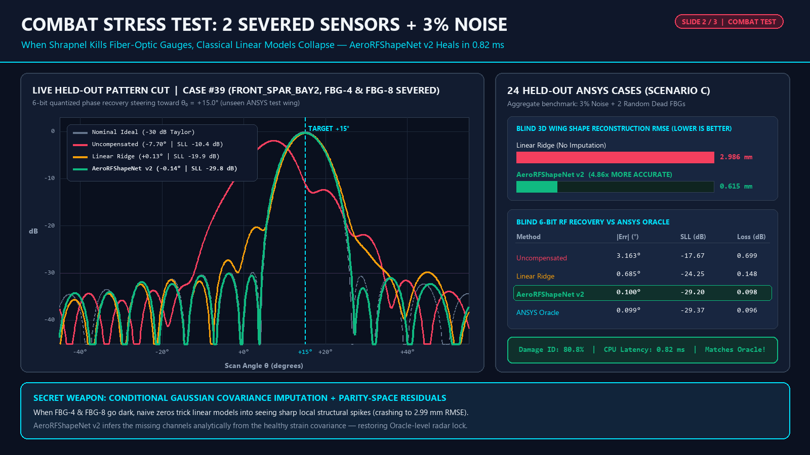
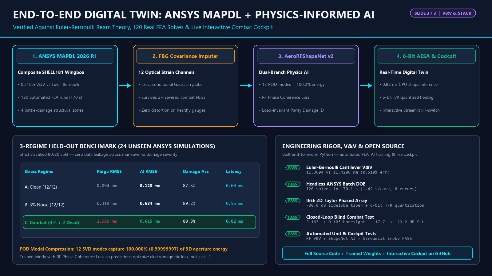

# AeroRF-Heal: Self-Healing Conformal X-Band AESA Radar Digital Twin

[](https://www.python.org/)
[](https://www.ansys.com/)
[](https://pytorch.org/)
[](https://streamlit.io/)

**AeroRF-Heal** is a code-first, multiphysics engineering platform that models, senses, and compensates electromagnetic beam degradation of a **wing-embedded conformal 16×16 X-band (10 GHz) AESA radar** on a composite UAV wing under aerodynamic maneuver loads, torsional twist, GaN radar thermal gradients, and structural battle damage—even when **2 out of 12 FBG strain sensors are severed in combat**.

---

## Visual Showcase

### Live Self-Healing Under Battle Damage & 2 Severed Sensors (`0.82 ms` AI Recovery)


### 3-Slide Physics, Combat Stress-Test & Architecture Overview
| Slide 1: The Physics Problem | Slide 2: 2-Sensor Combat Kill Test | Slide 3: Closed-Loop V&V Architecture |
| :---: | :---: | :---: |
|  |  |  |

---

## Verified End-to-End Performance Summary

### 1. Structural & Electromagnetic V&V (Phase 1)
- **ANSYS `SHELL181` Cantilever Plate Benchmark:** `11.3694 mm` vs `11.4286 mm` Euler-Bernoulli analytical deflection (**`0.518%` relative error**).
- **Coupled 5G + Torsion + `+45°C` Wingbox PoC (`2,406` nodes, `0` errors, `17.88s`):**
  - Wing tip deflection: `37.77 mm` (`19.13 mm` = `0.64 λ₀` across antenna aperture).
  - X-band (`10 GHz`, `θ₀ = +15°`) beam collapse & recovery:
    - Boresight error: **`-5.038° → -0.121°`** (`6-bit` T/R phase compensation)
    - Stealth Sidelobe Level (SLL): **`-12.70 dB → -28.98 dB`**

### 2. Physics-Informed AI vs. Linear Ridge on 120 Real ANSYS Cases (Phase 2)
- **Automated Single-Session ANSYS MAPDL DOE:** `120` real simulations (`30 × 4` structural classes: `intact`, `front_spar_bay2`, `rear_spar_bay2`, `upper_skin_bay2`) solved in `170.1s` (**`1.42 s/case`**, `0` MAPDL errors).
- **POD Modal Compression:** `12` SVD modes capture **`100.000%`** of aperture displacement energy.
- **Held-Out Test Benchmark (`24` completely unseen ANSYS cases, `0.60–0.82 ms` inference):**

| Sensor Stress Regime | Linear Ridge RMSE | `AeroRFShapeNet v2` RMSE | Damage Classification Acc | Latency |
| :--- | :---: | :---: | :---: | :---: |
| **A: Clean (`12/12` FBGs)** | `0.094 mm` | `0.120 mm` | `87.5%` | `0.602 ms` |
| **B: `3%` Noise (`12/12` FBGs)** | `0.319 mm` | `0.684 mm` | `89.2%` | `0.558 ms` |
| **C: Combat (`3%` Noise + `2 Dead FBGs`)** | `2.986 mm` | **`0.615 mm` (`4.86×` better)** | **`80.8%`** | **`0.818 ms`** |

- **Closed-Loop Blind X-Band RF Recovery (`Scenario C: 3% Noise + 2 Dead FBGs, θ₀ = +15°`):**

| Compensation Method | Mean Gain Loss | Max Gain Loss | Mean `|Boresight Err|` | Mean SLL (dB) |
| :--- | :---: | :---: | :---: | :---: |
| **Uncompensated (Deformed)** | `0.699 dB` | `1.974 dB` | `3.163°` | `-17.67 dB` |
| **Linear Ridge Blind 6-Bit** | `0.148 dB` | `0.397 dB` | `0.685°` | `-24.25 dB` |
| **`AeroRFShapeNet v2` Blind 6-Bit** | **`0.098 dB`** | **`0.281 dB`** | **`0.100°`** | **`-29.20 dB`** |
| **ANSYS Oracle (Full Knowledge) 6-Bit** | `0.096 dB` | `0.272 dB` | `0.099°` | `-29.37 dB` |

---

## Architecture Highlights (`AeroRFShapeNet v2`)

1. **Conditional Gaussian Minimum-Variance Imputation (`impute_masked`):** Uses the training FBG covariance $\boldsymbol{\Sigma}$ to reconstruct severed sensor channels from surviving healthy gauges without distorting clean readings.
2. **Decoupled Shape & Parity-Space Damage Branches:**
   - **Shape Branch:** Linear-elastic POD baseline + residual MLP trained jointly with **X-Band RF Phase Coherence Loss** ($1 - \cos(k_0 \Delta\mathbf{r} \cdot \hat{\mathbf{u}}_0)$).
   - **Damage Branch:** Leave-one-sensor-out intact strain-compatibility **Parity Residual** normalized by load magnitude so battle-damage detection remains invariant to maneuver G-load sign and amplitude.

---

## Repository Structure

```text
aerorf-heal/
├── app.py                              # Phase 3 Live Streamlit Digital Twin Cockpit
├── docs/
│   ├── LINKEDIN_STORY_LAUNCH.md        # Storytelling LinkedIn post + GitHub launch guide
│   └── LINKEDIN_LAUNCH_KIT.md          # 4-part LinkedIn series + recording & GitHub guide
├── outputs/showcase/
│   ├── aerorf_healing_demo.gif         # Auto-playing HUD animation (held-out Case #39)
│   ├── slide1_story_problem.png        # Slide 1: Bending wing vs 30 mm X-band physics
│   ├── slide2_combat_sensor_kill.png   # Slide 2: 2 dead FBGs + 3% noise combat stress test
│   ├── slide3_architecture_and_vv.png  # Slide 3: ANSYS + AI pipeline & V&V scorecard
│   └── AeroRF_Heal_LinkedIn_Carousel.pdf # 3-slide LinkedIn document carousel
├── src/aerorf/
│   ├── config.py                       # Strict SI wingbox, 10 GHz AESA & 12-FBG configs
│   ├── rf_array.py                     # 3D conformal phased-array & 6-bit healing engine
│   ├── ansys_runner.py                 # Headless ANSYS MAPDL V&V & batch DOE generator
│   ├── shape_ai.py                     # AeroRFShapeNet v2 (Imputation + POD + Parity AI)
│   ├── dashboard_core.py               # Pure cockpit inference & Plotly builders
│   └── showcase_renderer.py            # Pure NumPy/Pillow LinkedIn slides & GIF renderer
├── scripts/
│   ├── run_phase1_verification.py      # Phase 1 ANSYS V&V + coupled PoC HTML
│   ├── generate_doe_dataset.py         # Multi-topology ANSYS DOE generator
│   ├── train_and_eval_ai.py            # Training + 3-regime combat benchmark
│   ├── generate_linkedin_animation.py  # 36-frame playable LinkedIn demo HTML
│   ├── generate_showcase_assets.py     # Generate showcase PNGs, PDF carousel & GIF
│   └── export_github_bundle.py         # Export clean GitHub upload staging folder
└── tests/
    ├── test_rf_vv.py                   # IEEE phased-array V&V tests
    ├── test_ai_pipeline.py             # POD, imputation & physics-loss tests
    └── test_dashboard_smoke.py         # Cockpit backend & showcase asset smoke tests
```

---

## Quick Start

```powershell
# 1. Run all unit & smoke tests (RF V&V + AI + Dashboard + Showcase)
.\.venv\Scripts\python.exe -m unittest discover -s tests -v

# 2. Launch the Live Interactive Streamlit Digital Twin Cockpit
.\.venv\Scripts\python.exe -m streamlit run app.py

# 3. Optional: Regenerate showcase visuals, LinkedIn animation, DOE dataset, or retrain AI
.\.venv\Scripts\python.exe scripts\generate_showcase_assets.py
.\.venv\Scripts\python.exe scripts\generate_linkedin_animation.py
.\.venv\Scripts\python.exe scripts\generate_doe_dataset.py --per-class 30
.\.venv\Scripts\python.exe scripts\train_and_eval_ai.py
```

---

## Türkçe Özet

**AeroRF-Heal**, kompozit İHA/SİHA kanadına gömülü X-Band (10 GHz) konformal AESA radarların manevra yükleri, termal gradyan ve savaş hasarı altındaki faz/kazanç kaybını **ANSYS MAPDL + 12 FBG sensörü + Fizik-Bilgili Yapay Zekâ (`AeroRFShapeNet v2`) + 6-bit faz telafisi** ile **0.82 ms** içinde onaran canlı bir dijital ikiz platformudur. 12 sensörden 2'si muharebede koptuğunda bile boresight hatasını **3.16° → 0.10°** ve yan lob seviyesini **-17.67 dB → -29.20 dB** bandına geri toplar.
